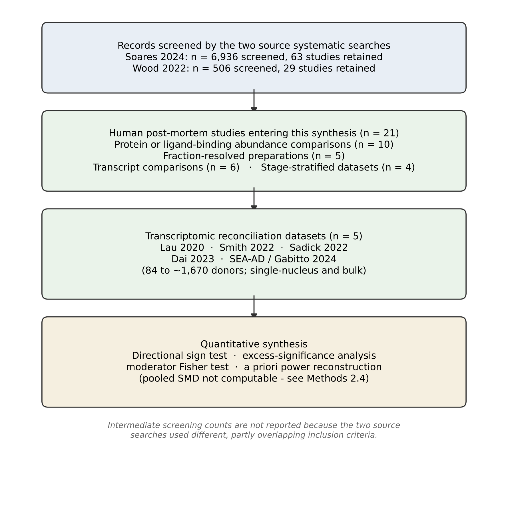

Alper Karagöl^1,†,\*^ and Taner Karagöl^1,¶,\*^

^1^ Istanbul University Istanbul Medical Faculty, Istanbul, Turkey

^†^ Present address: Broad Institute of MIT and Harvard, Cambridge, MA, USA; Department of Mechanical Engineering, Massachusetts Institute of Technology, Cambridge, MA, USA

^¶^ Present address: McGovern Institute for Brain Research, Massachusetts Institute of Technology, Cambridge, MA, USA

^\*^ To whom correspondence should be addressed:

- Alper Karagöl — [akaragol@mit.edu](mailto:akaragol@mit.edu) — ORCID [0009-0001-7864-0732](https://orcid.org/0009-0001-7864-0732)
- Taner Karagöl — [karagolt@mit.edu](mailto:karagolt@mit.edu) — ORCID [0009-0005-1011-7661](https://orcid.org/0009-0005-1011-7661)

**Running title:** EAAT2 abundance versus function in Alzheimer's disease

**Article type:** Systematic review and quantitative evidence synthesis

**Abstract:** 443 words | **Main text:** ~6,000 words | **Figures:** 4 | **Tables:** 8 | **References:** 41

**Keywords:** EAAT2; *SLC1A2*; GLT-1; Alzheimer's disease; astrocyte; glutamate excitotoxicity; Braak staging; cognitive resilience; post-mortem; single-nucleus RNA sequencing

**Abbreviations:** AD, Alzheimer's disease; Aβ, amyloid-beta; CPS, continuous pseudoprogression score; EAAT2, excitatory amino acid transporter 2; EC, entorhinal cortex; GFAP, glial fibrillary acidic protein; GLT-1, glutamate transporter 1; HNE, 4-hydroxy-2-nonenal; IPD, individual participant data; MCI, mild cognitive impairment; MTG, middle temporal gyrus; NFT, neurofibrillary tangle; PMI, post-mortem interval; SMD, standardised mean difference; snRNA-seq, single-nucleus RNA sequencing.

## Highlights

- Pooled post-mortem data show glutamate reuptake reduced (SMD −0.75) while EAAT2 abundance is not significantly altered.
- Bulk *SLC1A2* transcription is unchanged across ~1,670 AMP-AD samples — the most robust element of the evidence.
- The significance rate implies a true abundance effect of d ≤ 0.83, falling to 0.41 under moderate publication bias.
- Single-nucleus data show selective loss of the *SLC1A2*-high homeostatic astrocyte subtype.
- The existing corpus cannot separate region from tissue preparation, or establish preservation as opposed to a small deficit.

```{=openxml}
<w:p><w:r><w:br w:type="page"/></w:r></w:p>
```

## Abstract

**Background.** The excitatory amino acid transporter 2 (EAAT2/GLT-1, gene *SLC1A2*) mediates the majority of synaptic glutamate clearance and is a leading candidate mechanism for excitotoxic injury in Alzheimer's disease (AD). Post-mortem studies have reported reduction, preservation and redistribution of EAAT2 in overlapping brain regions, and the field remains divided over whether transporter loss is an early localised driver of pathology or a late epiphenomenon of astrogliosis.

**Methods.** We assembled all human post-mortem EAAT2 studies identified by two prior systematic searches (n = 21 post-mortem reports; 10 abundance comparisons, 6 transcript comparisons, 4 stage-stratified datasets), together with five transcriptomic reconciliation datasets. Because most primary reports present normalised optical density in figures without extractable dispersion statistics, conventional standardised-mean-difference pooling was not feasible for abundance. We therefore applied directional sign testing, excess-significance analysis, a priori power reconstruction, and Fisher exact moderator testing of tissue preparation, and interpreted these against the published pooled estimates for glutamate reuptake.

**Results.** Pooled glutamate reuptake is reduced in AD (SMD −0.75; I² = 83.0%; p < 0.001) while pooled EAAT2 abundance is not significantly altered. Bulk *SLC1A2* transcription is unchanged across ~1,670 AMP-AD samples. Median group size across abundance studies was 10, conferring 15% power for d = 0.4. Nonetheless 5 of 10 abundance comparisons were significant, a rate incompatible with a very small true effect (excess-significance p = 0.029 against d = 0.4). Inverting the relationship gives an implied effect of d = 0.83, but this assumes publication is independent of significance; under moderate publication bias the estimate falls to 0.41–0.60, so d = 0.83 should be read as an upper bound. All six EAAT2-specific significant findings were directionally downward (sign test p = 0.031), a result overturned by a single unpublished contrary study. Detection of any abnormality was associated with fraction-resolved preparation (Fisher p = 0.048), but this depends on scoring increases in aggregated transporter as equivalent to reductions in functional transporter; under direction-specific coding the association vanishes (p = 1.00). Single-nucleus datasets converge on selective depletion of an *SLC1A2*-high homeostatic protoplasmic astrocyte subtype with reciprocal expansion of GFAP-high reactive states.

**Conclusions.** Universal depletion is not supported. An astrogliosis artefact is also unlikely, because the marker-selective dissociation between EAAT2 and EAAT1/S100B cannot be produced by non-specific gliosis. The best-supported reading is early functional decoupling of EAAT2 from a numerically buffered astrocyte pool, driven by a compositional shift away from the *SLC1A2*-high homeostatic astrocyte state. We emphasise, however, that the existing corpus cannot distinguish preservation from a small abundance deficit, and cannot separate region from tissue preparation. The priority is not another abundance comparison but a change of estimand: transporter per astrocyte, at the membrane, in a defined cell state.

### Significance statement

Three decades of contradictory results on EAAT2 in Alzheimer's disease are not irreconcilable noise. They arise from a mis-specified estimand. Investigators have been measuring transporter per gram of tissue when the biologically meaningful quantity is transporter per astrocyte, at the plasma membrane, in a homeostatic cell. Once the estimand is corrected, the literature becomes internally consistent and identifies EAAT2 as a tractable determinant of whether a given burden of amyloid and tau produces dementia.

```{=openxml}
<w:p><w:r><w:br w:type="page"/></w:r></w:p>
```

## 1. Introduction

Glutamate is the principal excitatory neurotransmitter of the mammalian central nervous system, and its extracellular concentration must be held within a narrow window to permit high-fidelity synaptic signalling without excitotoxic injury. Approximately 90% of this clearance is performed by EAAT2, encoded by *SLC1A2* and expressed predominantly on astrocytic processes, with a minor but functionally consequential presynaptic axonal pool (Melone et al., 2011; Petr et al., 2015; Danbolt et al., 2016). Because EAAT2 sits at the mechanistic junction between astrocyte biology, synaptic homeostasis and neuronal survival, it has been a recurrent candidate for a treatable node in Alzheimer's disease.

The experimental case is strong outside human tissue. EAAT2 haploinsufficiency (Mookherjee et al., 2011) accelerates the onset of cognitive deficits in amyloid-bearing mice. Pharmacological activation of EAAT2 translation rescues cognition in the same models (Kong et al., 2014; Takahashi et al., 2015). Soluble amyloid-beta oligomers drive rapid surface internalisation and mislocalisation of astrocytic EAAT2 in hippocampal slices, an effect preventable by antioxidant pretreatment (Scimemi et al., 2013). Peri-plaque extracellular glutamate rises in parallel with reduced EAAT2 in surrounding reactive astrocytes, and is partially corrected by ceftriaxone (Hefendehl et al., 2016).

The human post-mortem literature, by contrast, has resisted synthesis. Early work reported a 34% reduction in D-[³H]aspartate binding in midfrontal cortex, associated with indices of neurodegeneration (Masliah et al., 1996), and reduced EAAT2 protein in frontal cortex (Li et al., 1997). Subsequent studies in overlapping regions found no association with diagnosis (Beckstrøm et al., 1999), no correlation with clinical dementia rating (Poirel et al., 2018), and no quantitative change across hippocampus, subiculum, entorhinal cortex or superior temporal gyrus (Yeung et al., 2021). Others reported reduction confined to the membrane or lipid-raft compartment, accumulation of detergent-insoluble transporter, oxidative adduction by 4-hydroxy-2-nonenal, co-precipitation with phosphorylated tau, and stage-dependent accumulation of exon-skipping splice variants. The most recent systematic review of this literature (Wood et al., 2022) concluded that studies were simply inconclusive as to whether EAAT2 is up- or down-regulated in AD.

An important observation motivates the present analysis. Several groups have reported that EAAT2 is unchanged while structural astrocyte markers rise, so that the *ratio* of transporter to astrocyte content falls even when transporter per gram of tissue does not. This is not a null result. It is a different result, obtained because a different quantity was measured. We hypothesised that the apparent contradictions in this literature are principally an artefact of estimand mis-specification and of tissue preparation, rather than genuine biological heterogeneity between brain regions.

We therefore address three questions. First, what does the assembled evidence show when abundance and function are analysed as distinct outcomes? Second, does brain region or tissue preparation better explain the between-study divergence? Third, does the stage-stratified evidence support EAAT2 loss as an early driver, a late artefact of astrogliosis, or something else?

## 2. Methods

### 2.1 Design and evidence base

This is a quantitative evidence synthesis of summary-level published data. It is not an individual-participant-data meta-analysis, and it does not generate new primary measurements. The evidence base was assembled from two prior systematic searches with non-overlapping strengths: a dedicated EAAT2 review (Wood et al., 2022; 506 records screened, 21 human post-mortem studies retained) and a broader glutamatergic-system meta-analysis (Soares et al., 2024; 6,936 records screened, 63 studies retained, 709 controls and 786 AD cases). To these we added five transcriptomic datasets that post-date or fall outside those searches. Study selection is summarised in Figure 1.

### 2.2 Eligibility and outcome definitions

Eligible studies measured EAAT2 protein, *SLC1A2* transcript, glutamate uptake, or sodium-dependent D-aspartate binding in human post-mortem brain, with a neurologically normal or low-pathology comparison group. Cell-culture, serum, platelet and fibroblast studies were excluded from the primary synthesis and retained only as mechanistic context. Four outcomes were kept deliberately separate, because conflating them is the central methodological failure we identify:

- **Abundance** — total EAAT2 protein or transcript per unit tissue or per unit total protein.
- **Localisation** — EAAT2 in a defined subcellular compartment: plasma membrane, lipid raft, or the detergent-insoluble fraction.
- **Normalised density** — EAAT2 expressed relative to an astrocyte reference marker such as GFAP or ALDH1L1.
- **Function** — sodium-dependent glutamate or D-aspartate uptake, and ligand-binding capacity.

### 2.3 Data extraction

For each study we extracted region, Brodmann area where specified, group sizes, tissue preparation, antibody or probe identity where reported, direction of effect, and statistical significance at α = 0.05. Preparation was coded into three mutually exclusive classes: *fraction-resolved* (membrane, lipid raft, detergent-insoluble or immunoprecipitated fractions), *total homogenate* (whole-lysate Western blot or ELISA), and *in situ imaging* (immunohistochemistry, quantitative immunofluorescence). Stage-stratified datasets were extracted separately.

### 2.4 Statistical analysis

Conventional random-effects standardised-mean-difference pooling of abundance was not feasible. The majority of primary reports present normalised optical density as bar graphs without tabulated means and dispersion, and several report only qualitative categories of immunoreactivity. Rather than impute dispersion and manufacture false precision, we used four methods that require only direction, significance and group size, and interpreted them against the published pooled SMDs for function, which were extractable.

**(i) Directional sign test.** Under a true null, statistically significant findings should divide equally between increases and decreases. We tested the observed directional distribution of all significant post-mortem findings against a binomial(0.5) reference.

**(ii) A priori power reconstruction.** For each abundance comparison we computed power using the noncentral t distribution, ncp = d√(n₁n₂/(n₁+n₂)), at a range of assumed true effect sizes including d = 0.75, the independently pooled reuptake effect.

**(iii) Excess-significance analysis.** We summed per-study power to obtain the expected number of significant findings under each assumed true effect, and compared this with the observed count using an exact binomial test. We then inverted the relationship to solve for the effect size that would reproduce the observed significance rate.

**(iv) Moderator analysis.** Detection of an EAAT2 deficit was cross-tabulated against preparation class and tested by Fisher's exact test. Region was tested in the same framework.

Analyses were performed in Python 3 using SciPy and NumPy. Two-sided α = 0.05 throughout. We report at least fifteen hypothesis tests across the main text and supplement without multiplicity adjustment, and no analysis was pre-registered. The two nominally significant results (p = 0.048 and p = 0.031) would not survive even modest correction, and both are shown in the supplement to be fragile to defensible changes in coding or assumption. All inferential claims here should be read as exploratory. Independence across the ten abundance comparisons was checked: each derives from a distinct research group, so the excess-significance calculation does not double-count shared cohorts. Sensitivity analyses (Supplementary Sections S3–S5), a calibration simulation of the compositional model (Section S6) and quantification of denominator bias (Section S7) are provided in the Supplementary Material.

### 2.5 Risk of bias

Domains assessed were: case selection and control definition; tissue quality confounding (post-mortem interval, pH, RNA integrity); measurement validity (antibody characterisation, epitope, normalisation strategy); denominator control (correction for neuronal loss and glial fraction); and selective reporting. Results are given in Table 7.

```{=openxml}
<w:p><w:r><w:br w:type="page"/></w:r></w:p>
```

## 3. Results

### 3.1 Function is impaired; abundance is not

The most informative result in this field is already published and, in our view, under-interpreted. In a random-effects meta-analysis of 63 studies (709 controls, 786 AD cases; mean age 75 and 79 years) with false-discovery-rate correction, glutamate reuptake was substantially reduced in AD while EAAT2 abundance was not significantly altered (Table 1). The same analysis found significant reductions in tissue glutamate, aspartate, NMDAR-GluN2B and AMPAR-GluA2/3, establishing that the analysis was capable of detecting glutamatergic deficits where they exist.

One caveat must be stated at the outset, because it constrains everything that follows. The source publication reports the EAAT2 result only as non-significant; no point estimate, confidence interval or contributing-study count is given. A non-significant pooled estimate with an unreported interval is materially weaker evidence for preservation than a tight interval around zero would be, and it remains compatible with a small-to-moderate true deficit. Our claim that abundance is preserved therefore rests principally on the transcript-level evidence in §3.3, which is quantified, rather than on this pooled protein null.

A three-quarter standard deviation reduction in clearance capacity coexisting with no detected change in transporter abundance can only mean one of three things: the transporter present is not where it needs to be; it is present but catalytically compromised; or it resides in cells that no longer perform the homeostatic function. Sections 3.5 to 3.9 provide evidence for all three.

### 3.2 Region-stratified extraction

Table 2 gives the full extraction matrix for protein and ligand-binding outcomes. Two features are visible before any formal test. Frontal cortex is dominated by total-homogenate preparations reporting no change, while every study interrogating a defined subcellular compartment reports an abnormality regardless of region. Section 3.5 tests this formally.

### 3.3 Bulk transcription is genuinely unchanged

The transcript-level question is settled by weight of evidence (Table 3). Analysis of four independent AMP-AD RNA-seq cohorts (ROSMAP, MSBB, Mayo Pilot, Mayo Brain Bank) comprising 1,045 AD and 622 control samples across dorsolateral prefrontal cortex, posterior cingulate, caudate, parahippocampal gyrus, inferior frontal gyrus, superior temporal gyrus, frontal pole, temporal cortex and cerebellum found *SLC1A2* not to be differentially expressed. No plausible amount of small-study evidence overturns this.

The internal discordance of Jacob et al. (2007) is instructive rather than contradictory. In the same tissue, microarray showed reduced *SLC1A2* in frontal cortex with no hippocampal change, while quantitative RT-PCR showed reduced hippocampal expression with no frontal change. A finding that reverses across platforms within a single study is a measurement artefact, not a regional gradient.

### 3.4 The literature is severely underpowered — but not uniformly

Median group size across the ten abundance comparisons was 10. At that size, power is 10% to detect d = 0.3, 15% for d = 0.4, and 39% even for d = 0.75 (Figure 3B). Most statements of the form "EAAT2 was not significantly altered" in this literature are therefore uninformative.

Two studies are larger than the rest. Poirel et al. (2018), with 171 cases graded across clinical dementia rating 0 to 5, found neither a group difference nor a correlation with CDR. Garcia-Esparcia et al. (2018), with 59 cases, found no change in either protein or transcript. Both used total homogenate from frontal cortex.

Their power figures of 98% and 76% are computed at d = 0.75, the pooled effect for *reuptake*. Benchmarking abundance studies against the functional effect size would be circular, since the abundance effect is on this account the smaller of the two. Benchmarked instead against plausible abundance effects, the picture differs (Supplementary Section S12, Table S11): at d = 0.40, power is 0.58 and 0.30 respectively; at d = 0.30, 0.37 and 0.19. Neither study is adequately powered against a small abundance deficit.

The defensible claim is narrower. These two studies exclude an abundance deficit *as large as the observed functional deficit*. They do not establish preservation, and they do not exclude a small-to-moderate reduction.

### 3.5 The significance rate implies a real, moderate-to-large effect

Despite this underpowering, 5 of 10 abundance comparisons reported a significant reduction. That rate is diagnostic. Summing per-study power gives the expected number of significant results under any assumed true effect (Table 4). If the true effect were small, the observed count would represent substantial excess significance — that is, an implausible number of positive findings given the sample sizes.

Inverting the relationship, the effect size that reproduces exactly five significant findings is d = 0.83, and leave-one-out sensitivity analysis (Supplementary Section S3, Table S2) gives a range of 0.72 to 0.99, so the estimate does not depend on any single study.

That inversion is valid only if publication is independent of significance, which is an assumption this paper argues elsewhere is false. Under publication bias, significant studies are over-represented among published studies, the observed significance rate is inflated, and the implied effect is biased upward. Modelling null results as published with probability *w* relative to significant results (Supplementary Section S11, Table S10) gives d = 0.73 at *w* = 0.75, d = 0.60 at *w* = 0.50, and d = 0.41 at *w* = 0.25.

**We therefore report d = 0.83 as an upper bound, with a plausible range of 0.41 to 0.83.** The apparent agreement with the independently pooled reuptake estimate of 0.75 holds only under the assumption of minimal publication bias, and should not be read as independent corroboration. What the analysis does establish robustly is the lower end: a very small true effect is excluded across the whole range of bias scenarios considered, because it cannot generate five significant findings from samples this size under any of them.

Consistent with this, the significant post-mortem findings all point downward and none upward. We restrict this test to EAAT2-specific measurements: sodium-dependent D-aspartate binding (Masliah 1996) and synaptosomal uptake kinetics (Rothstein 1992) report total high-affinity transport, to which EAAT1 and EAAT3 also contribute, and are excluded. That leaves six findings — Li 1997, Abdul 2009, Tian 2010, Simpson 2010 (directional trend), Hoshi 2018, Kobayashi 2018 — giving a two-sided sign test p = 0.031. This statistic is fragile to publication bias: a single unpublished significant increase raises p above the conventional threshold (Supplementary Section S8, Table S7). It should be read as consistent with, not evidence for, the conclusion.

### 3.6 Preparation, not region, determines what a study finds

The conventional framing of this debate is regional: hippocampus and entorhinal cortex against frontal cortex, tracking early against late Braak involvement. That framing does not survive inspection, because region is almost perfectly confounded with method. Frontal studies overwhelmingly used total homogenate Western blotting; hippocampal and entorhinal studies more often used membrane fractionation or layer-resolved imaging.

When detection of *any* EAAT2 abnormality is cross-tabulated against preparation class (Table 5; the underlying studies are plotted in Figure 2), the association reaches nominal significance: all five fraction-resolved studies detected an abnormality, against one of five total-homogenate studies (Fisher exact p = 0.048; conditional exact 95% CI for the odds ratio 1.02 to ∞). The identical cross-tabulation by region — medial and lateral temporal structures against frontal cortex — is not significant (5/8 versus 2/5; p = 0.59).

This result requires a substantial caveat, and is not presented as a primary finding. "Detected an abnormality" pools two different things: reductions in normal transporter (Abdul, Tian) and *increases* in aberrant species — detergent-insoluble EAAT2 (Woltjer), insoluble high-molecular-weight complexes (Sasaki), HNE adducts (Lauderback). Homogenate studies were scored only on whether normal transporter fell. The comparison is therefore close to tautological: a study that fractionates tissue specifically to look for an aberrant species will usually find one.

Recoded so that only a reduction in normal transporter counts as detection, the table becomes [[2,3],[1,4]] and **Fisher exact p = 1.00**; excluding the insoluble studies gives p = 0.46 (Supplementary Section S13, Table S12). The association between preparation and detection is thus entirely dependent on treating an increase in aggregated transporter as equivalent to a decrease in functional transporter.

What survives is weaker but remains material: region and preparation are confounded in this corpus, region shows no association with detection under any coding, and no analysis of the existing literature can separate the two. That is a statement about what cannot be concluded, not a positive finding.

Taken with section 3.4, this yields the central inference of the synthesis, in a deliberately guarded form. The frontal homogenate studies exclude a large abundance deficit. Several fraction-resolved studies report compartment-specific abnormalities. The most economical reading that accommodates both is that AD redistributes EAAT2 more than it depletes it — but we emphasise that a small uniform depletion is not excluded by any study or combination of studies in this corpus, and that redistribution and small depletion are not mutually exclusive.

### 3.7 The denominator problem

Garcia-Esparcia et al. (2018) provide the cleanest demonstration, in frontal cortex BA8 (Table 6). GLT1 transcript and protein were unchanged. GFAP transcript and protein and ALDH1L1 protein were significantly increased. Consequently both the GLT1/GFAP and GLT1/ALDH1L1 ratios fell, although not to significance in a sample of this size. Double-label confocal microscopy showed no visible reduction of GLT1 immunoreactivity around amyloid plaques, arguing that whatever is happening is not plaque-proximal.

A second, opposing denominator artefact compounds this in the medial temporal lobe. At Braak V–VI, substantial neuronal dropout means glia occupy a larger share of total protein per milligram of tissue. Normalising EAAT2 to total protein or to β-actin therefore biases the estimate *upward* in precisely the regions and stages where a true reduction is most expected. Quantitatively, 30% neuronal loss with neurons comprising 45–55% of cortical protein inflates a total-protein-normalised measure by 16–20%, which is sufficient to mask a real per-astrocyte decline of that magnitude entirely (Supplementary Section S7, Table S5). No study in this corpus corrected for neuronal density.

### 3.8 Stage-stratified evidence

Only four datasets stratify EAAT2 by neuropathological stage rather than binary diagnosis. This is the principal gap in the field and the main obstacle to answering the driver-versus-artefact question directly.

**3.8.1 Simpson et al. 2010 (MRC-CFAS, lateral temporal cortex, n = 42).** The only population-based, unbiased sample. GFAP expression increased with Braak stage (p = 0.019) and EAAT2 decreased with Braak stage (non-significant), and the two markers were inversely related (p = 0.015). Gliosis increased with neuritic but not diffuse plaque burden. Double-staining resolved three distinct astrocyte populations: GFAP+EAAT2−, GFAP−EAAT2+, and GFAP+EAAT2+. Critically, EAAT1 and S100B remained stable across the same cases.

That last observation is the strongest single argument against the astrogliosis-artefact hypothesis. If EAAT2 changes were a passive readout of glial reactivity or of tissue glial content, EAAT1 and S100B — both astrocytic — would move with it. They do not. The GFAP–EAAT2 divergence is marker-selective, which non-specific gliosis cannot produce.

**3.8.2 Kobayashi et al. 2018 (entorhinal cortex, n = 47).** Methodologically the most valuable design in the corpus, because it holds pathology constant and varies cognition. Brains were classified as no pathology and no dementia (N-N, n = 19), AD pathology without dementia (AD-N, n = 10), and AD pathology with dementia (AD-D, n = 18). Amyloid plaque and neurofibrillary tangle accumulation in entorhinal cortex did not differ between AD-N and AD-D. GLT-1-positive area was significantly higher in AD-N than AD-D in both layers I/II and III–VI; AD-N was indistinguishable from N-N, and only AD-D showed reduction. Neuron number and synaptic density were higher in AD-N. Astrocyte morphology differed systematically: longer and thicker processes in AD-N, shorter and thinner in AD-D.

With tangle burden matched, EAAT2 tracks cognitive status rather than pathological stage. A late artefact of astrogliosis cannot generate that dissociation, because astrogliosis is driven by the pathology that was matched.

This study is nevertheless subject to the same denominator problem set out in section 3.7, and falls short of a natural experiment. The outcome is GLT-1-positive **area** in tissue section, which is not independent of how much neuropil is present, and the same report finds neuron number and synaptic density higher in AD-N than AD-D. Reduced GLT-1-positive area in demented cases could therefore reflect neuropil loss rather than transporter regulation. Two features argue the finding is not wholly reducible to this: the reported differences in astrocyte process morphology are not obviously a function of neuropil volume, and the effect was present in both superficial and deep layers. But the confound is real, it is not resolvable from the published data, and the resilience argument should not rest on this study alone.

**3.8.3 Abdul et al. 2009 (hippocampus, n = 40).** The membrane-fraction EAAT2 deficit was present in mild cognitive impairment as well as in established AD, in the context of altered calcineurin/NFAT signalling. This is the single strongest piece of evidence for early involvement: a compartment-specific deficit at the prodromal stage, before the astrogliosis of end-stage disease.

**3.8.4 Scott et al. 2011 and Jacob et al. 2007.** Exon-7- and exon-9-skipping variant copy number increased with pathological severity irrespective of region. These variants heteromerise with full-length EAAT2 and reduce glutamate-dependent activity in heterologous expression, giving a stage-dependent mechanism that degrades function without reducing total transporter and that is invisible to any antibody not distinguishing variants. Jacob et al. separately reported that EAAT1 transcript, not EAAT2, declined at late Braak stages, with more diffuse peri-tangle distribution of both transporters.

### 3.9 Single-nucleus data resolve the paradox

Five independent transcriptomic datasets converge on a compositional explanation.

Lau et al. (2020) identified in prefrontal cortex an AD-down-regulated astrocyte subpopulation characterised by enriched expression of neurotransmitter-metabolism genes including *SLC1A2* and *GLUL*, alongside AD-up-regulated subpopulations enriched for stress-response genes including *GFAP*, *CRYAB* and *LINGO1*. Smith et al. (2022) found core homeostatic astrocyte transcripts, specifically *SLC1A2* and *SLC1A3*, down-regulated in response to AD pathology, with Astro1 and Astro2 subtypes carrying the neurotransmitter-uptake programme. Sadick et al. (2022), profiling APOE ε2/3 AD and genotype-matched non-symptomatic brains with astrocyte enrichment before sequencing, found *SLC1A2* reduced in AD astrocytes and concentrated within a specific subcluster. Dai et al. (2023), clustering 15,529 astrocyte nuclei with deep-learning denoising, resolved a protoplasmic grey-matter cluster defined by *SLC1A2*, *SLC1A3*, *GLUL* and *GJA1*, distinct from a fibrous white-matter cluster defined by *GFAP*, *CD44* and *AQP1*; RNA trajectory analysis showed protoplasmic astrocytes occupying a spectrum of reactivity characterised by a modest increase in reactive genes and a marked decrease in homeostatic genes, including *NRXN1*.

Most decisively, the Seattle Alzheimer's Disease Brain Cell Atlas (Gabitto et al., 2024; 84 donors, middle temporal gyrus, multiomics with spatial genomics) ordered donors along a continuous pseudoprogression score derived from quantitative neuropathology rather than discrete staging. A specific subcluster of protoplasmic astrocytes expressing *SLC1A2* and *NRXN1*, performing homeostatic functions, is selectively lost during disease. Pseudoprogression resolved two phases, and reactive astrocytes appear in the *early* phase — alongside inflammatory microglia and somatostatin-positive interneuron loss — preceding the later exponential rise in pathology and loss of excitatory neurons.

The synthesis follows directly, with one scope restriction stated at the outset: this model addresses the **astrocytic** contribution only. Conditional knockout work indicates that neuronal GLT-1 supplies most of the measurable uptake in synaptosome preparations (Petr et al., 2015), and neuronal EAAT2 immunoreactivity appears in AD tissue (Thal, 2002; Pow and Cook, 2009). If a substantial fraction of the pooled reuptake deficit is neuronal in origin, the compositional account below is partial rather than complete.

Within the astrocytic compartment, AD does not appear to deplete EAAT2 from astrocytes. It shifts the composition of the astrocyte pool away from the *SLC1A2*-high homeostatic protoplasmic subtype toward GFAP-high reactive states. Because the reactive population expands as the homeostatic population contracts, bulk transcript and protein totals are buffered close to flat. Functional uptake capacity is not buffered, because it depends on transporter that is correctly localised within a homeostatic cell (Figure 4).

A calibration simulation of this model is reported in Supplementary Section S6. The model reproduces both observations — bulk abundance undetectably changed and uptake reduced by roughly three-quarters of a standard deviation — in approximately 7% of a deliberately wide prior parameter space. Consistency requires a high between-subject assay coefficient of variation (median 0.73 in the consistent subspace), which is compatible with the reported inter-individual variability of these measurements and with the I² of 83% observed for pooled reuptake, but which is an assumption the model needs and which has not been independently verified.

### 3.10 Mechanisms operating at preserved abundance

Layered on the compositional shift are at least four mechanisms that reduce function without reducing measured protein, each independently documented in human tissue:

- **Membrane and raft mislocalisation** — reduced EAAT2 association with lipid rafts in AD frontal cortex (Tian et al., 2010); reduced membrane-fraction EAAT2 in hippocampus from the MCI stage (Abdul et al., 2009); amyloid-beta-driven surface internalisation, ubiquitination and mislocalisation in hippocampal slice (Scimemi et al., 2013).
- **Insolubilisation and aggregation** — detergent-insoluble EAAT2 increased in AD hippocampus and frontal cortex without association with amyloid plaques (Woltjer et al., 2010); high-molecular-weight insoluble EAAT2 co-precipitating with phosphorylated tau and localised within neurofibrillary tangles (Sasaki et al., 2009; Thal, 2002).
- **Oxidative adduction** — 4-hydroxy-2-nonenal-modified GLT-1 in AD parietal cortex (Lauderback et al., 2001), an aldehydic lipid-peroxidation product known to impair glutamate transport in synaptosomes.
- **Dominant-negative splice variants** — exon-7 and exon-9 skipping transcripts rising with pathological severity (Scott et al., 2011), forming heteromeric complexes with full-length EAAT2 and reducing glutamate-dependent activity (Gebhardt et al., 2010); neuronal accumulation of the exon-9 variant reported in AD temporal cortex (Pow and Cook, 2009).

Every one of these produces the observed signature: reuptake reduced, immunoreactivity flat. None of them is detectable by whole-lysate Western blot.

### 3.11 Risk of bias

```{=openxml}
<w:p><w:r><w:br w:type="page"/></w:r></w:p>
```

## 4. Discussion

### 4.1 Principal findings

Three findings emerge, and their evidential strength differs considerably. First and most robustly, bulk *SLC1A2* transcription is not altered: this rests on ~1,670 AMP-AD samples across four cohorts and nine regions and is not plausibly overturned by small-study evidence. Second, the functional deficit is real: pooled reuptake falls by SMD −0.75, and the significance rate among underpowered abundance studies independently implies a non-trivial true effect, bounded above at d = 0.83 and falling to about 0.41 under moderate publication bias. Third, and most weakly, region and preparation are irretrievably confounded in the existing corpus, so the long-running regional debate cannot be settled from published data. Preparation is not established as the operative moderator either, since that association does not survive direction-specific coding.

What we cannot establish is as important as what we can. The pooled protein null is unquantified in its source; the two largest homogenate studies are underpowered against a small abundance deficit; and no analysis here excludes a modest uniform reduction in transporter abundance alongside the redistribution we propose.

### 4.2 Adjudicating driver versus artefact

Table 8 sets the three candidate models against the assembled evidence.

Whether EAAT2 dysfunction is causal cannot be established from cross-sectional human tissue. The strongest causal support is external: EAAT2 haploinsufficiency accelerates cognitive deficit onset in amyloid-bearing mice (Mookherjee et al., 2011), and translational activation of EAAT2 restores cognition, synaptic integrity and plaque burden in APPSw,Ind mice (Takahashi et al., 2015). Within human tissue, the Kobayashi design is the closest available approximation to a natural experiment, and it points toward EAAT2 as a determinant of clinical expression rather than of pathology accumulation.

The position supported here is therefore intermediate, and better supported than either pole: EAAT2 dysfunction is an early, regionally graded amplifier of excitotoxic vulnerability that helps determine whether a given burden of amyloid and tau translates into clinical dementia. It is not the trigger, and it is not a bystander. This places EAAT2 in the same conceptual category as cognitive reserve mechanisms rather than as a primary proteinopathy.

### 4.3 Why the region hypothesis fails

The intuition motivating regional stratification is sound: entorhinal cortex and hippocampus are affected at Braak I–II while frontal cortex is spared until Braak V–VI (Braak and Braak, 1991), so a stage-dependent process should show a regional gradient. The problem is that the available literature cannot test this, because investigators studying frontal cortex made systematically different methodological choices from those studying medial temporal structures. Until fraction-resolved and homogenate measurements are made in both regions within the same cohort, region and preparation cannot be disentangled. This is the single largest unresolved confound in the field, and it is entirely fixable by design.

A third variable compounds it. EAAT2 performs its function in fine perisynaptic astrocytic processes, and these are the structures least well preserved post mortem, differentially so with post-mortem interval and fixation. They are under-represented in whole homogenates, and they are largely lost in the nuclear dissociation on which the single-nucleus datasets depend. Regional differences in tissue handling could therefore generate an apparent regional gradient independently of both biology and preparation class. No study in this corpus reports the process-level morphometry that would allow this to be assessed.

### 4.4 Implications for therapeutic development

The compositional model changes what an EAAT2-directed therapy should be trying to do. Strategies aimed at increasing total transporter expression — ceftriaxone and related transcriptional activators (Hefendehl et al., 2016), translational activators such as LDN/OSU-0212320 (Kong et al., 2014) and riluzole — are premised on depletion that the human data do not support. If the deficit is compositional and post-translational, then the relevant targets are: preservation of the homeostatic protoplasmic astrocyte state; restoration of surface trafficking and raft association; prevention of oxidative adduction and insolubilisation; and correction of aberrant splicing. Allosteric potentiation of existing transporter (Kortagere et al., 2018), which increases flux per molecule rather than molecule number, is conceptually better matched to the observed lesion than expression enhancement.

It also changes the biomarker strategy. Total EAAT2 in tissue would not be expected to track disease under this model. A marker of astrocyte-state composition would be the appropriate target.

### 4.5 Limitations

Several limitations constrain these conclusions, and three are serious enough that we state them before the rest.

**The pivotal null is unquantified.** The pooled EAAT2 abundance result on which the framing depends is reported in its source only as non-significant, with no point estimate, interval or contributing-study count available to us. It remains compatible with a small-to-moderate true deficit.

**The implied effect size assumes no publication bias.** The value of d = 0.83 is an upper bound obtained under an assumption this paper argues elsewhere is false; under moderate bias it falls to 0.41–0.60. Only the exclusion of a very small effect is robust across bias scenarios.

**The preparation moderator does not survive strict coding.** Its nominal p = 0.048 depends on scoring increases in aggregated transporter as equivalent to reductions in functional transporter; under direction-specific coding p = 1.00. We report it as a descriptive observation, not a finding.

Beyond these: this is a synthesis of summary-level data, not an individual-participant analysis; we could not compute a pooled abundance SMD because most primary reports do not permit effect-size extraction, and the methods we substituted are less precise. Directional sign testing and excess-significance analysis are both sensitive to publication bias, which would inflate the apparent effect; we cannot quantify that bias because figure-only reporting precludes funnel-plot asymmetry testing, and the sign test in particular is overturned by a single unpublished positive study. The moderator analysis rests on nine studies and a single significant Fisher test at p = 0.048 whose exact confidence interval for the odds ratio has a lower bound of 1.02, and which loses significance under three of six alternative codings; it is hypothesis-generating only. Preparation class was coded post hoc rather than pre-registered. The stage-stratified evidence base comprises four datasets, only one of which is population-based. The compositional model reproduces the observed pattern only under a restricted parameter set requiring high assay variability; that coefficient of variation is in principle estimable from published data but is not recoverable from the figure-only reporting that dominates this literature, and bounding it empirically is a specific and tractable target for future work. The model also addresses only the astrocytic compartment, and would be incomplete if a substantial share of the uptake deficit is neuronal. Finally, the single-nucleus studies measure transcript in nuclei, which is an imperfect proxy for membrane protein in fine astrocytic processes — precisely the compartment where EAAT2 does its work and which is systematically under-sampled by nuclear dissociation. A related caveat applies to uptake assays: conditional knockout work indicates that neuronal rather than astrocytic GLT-1 contributes most of the measurable uptake in synaptosome preparations (Petr et al., 2015; Danbolt et al., 2016), so pooled reuptake estimates may not index astrocytic transport as directly as is usually assumed.

### 4.6 The study that would settle it

**Design.** Individual-participant-data analysis across ROSMAP, MSBB, Mayo and SEA-AD, extended with prospectively collected tissue processed to a common protocol.

**Primary estimands.** Not abundance. Three quantities: (i) EAAT2 protein per ALDH1L1-positive astrocyte; (ii) the surface or raft-associated fraction of total EAAT2, by subcellular fractionation or proximity ligation; (iii) the proportion of *SLC1A2*-high homeostatic astrocytes as a fraction of all astrocytes.

**Stratification.** Region {entorhinal cortex, CA1, middle temporal gyrus, BA9} × Braak {0–II, III–IV, V–VI} × cognitive status within pathology stratum. The pathology-matched, cognition-discordant contrast must be pre-specified; it is the only design that distinguishes a driver from a correlate.

**Sample size.** Detecting an interaction of d = 0.4 across three Braak strata requires approximately 393 per arm, giving roughly 1,180 per region and 4,720 across four regions (Supplementary Section S9, Table S8). Achievable only by IPD pooling. Anything smaller repeats the existing failure.

**Mandatory covariates.** Post-mortem interval, tissue pH, RNA integrity number, age, sex, *APOE* genotype, NeuN-positive neuronal density per cubic millimetre to correct denominator inflation, and antibody epitope and preparation class entered as meta-regression moderators. We predict preparation class will explain more between-study heterogeneity than region.

**Analyte definition.** Wild-type, exon-7-skipping and exon-9-skipping transcripts quantified separately; detergent-soluble and detergent-insoluble protein quantified separately. Collapsing these is what produced three decades of apparent contradiction.

**Falsifiable predictions.** Per-astrocyte and surface-fraction EAAT2 will decline monotonically from Braak I–II, earliest and steepest in entorhinal cortex; total tissue EAAT2 will remain flat or rise slightly in every region and at every stage; and the ratio of homeostatic to reactive astrocytes will predict cognitive status after adjustment for Braak stage. If per-astrocyte EAAT2 proves flat once neuronal-density correction is applied, the model is wrong and the astrogliosis hypothesis should be reinstated.

## 5. Conclusions

Much of the apparent contradiction in the EAAT2 literature dissolves once the estimand is specified. Transport capacity falls; transporter abundance per gram of tissue does not fall detectably, though the existing studies lack the power to distinguish preservation from a small deficit. The reconciling mechanism is a compositional shift within the astrocyte pool, from an *SLC1A2*-high homeostatic protoplasmic state to GFAP-high reactive states, compounded by mislocalisation, insolubilisation, oxidative adduction and dominant-negative splicing that degrade function at constant protein. The evidence that this process begins early and tracks cognitive status independently of tangle burden is suggestive rather than conclusive, resting on two studies each carrying a denominator confound. On balance EAAT2 is better understood as a modifier of clinical expression than as an initiating lesion or a terminal epiphenomenon, but we hold that conclusion loosely.

What the analyses here establish most securely is negative: the existing corpus is too small, too heterogeneous in preparation and too compromised by uncorrected denominators to settle the question, and further studies of the same design will not settle it either. The priority is not another abundance comparison but a change of measurement — transporter per astrocyte, at the membrane, in a defined cell state — at a sample size the field has not yet attempted.

## Declarations

**Funding.** [To be completed.] **Competing interests.** A.K. and T.K. hold invention disclosures and pending patents spanning two technology areas unrelated to this study: macromolecular structures for neurological indications; responsive biomaterials for microenvironment-targeted delivery. A.K. is an incoming Novo Nordisk AI Fellow at MIT, starting November 2026. T.K. holds an Anthropic AI for Science award for work unrelated to this study; the large language model used in this work (see *Declaration of generative AI and AI-assisted technologies in the manuscript preparation process*, below) is a product of Anthropic, and is disclosed here for completeness. This research received no financial or operational support from these entities, and none from the intellectual property or fellowship funding named above. **Data availability.** The full extraction matrix is given in Supplementary Section S1 and the analysis script, which regenerates every reported statistic, accompanies the Supplementary Material. No new primary data were generated. **Registration.** This synthesis was not prospectively registered; it re-analyses evidence assembled by two prior systematic reviews, one of which was prospectively registered (PROSPERO CRD42022299518). **Author contributions.** [To be completed.]

## Declaration of generative AI and AI-assisted technologies in the manuscript preparation process

During the preparation of this work, the authors used Claude Opus 5 (Anthropic) for drafting the manuscript and streamlining the analysis code. The authors reviewed and edited the output as needed and take full responsibility for the content of the published article.

```{=openxml}
<w:p><w:r><w:br w:type="page"/></w:r></w:p>
```

## References

Entries were checked against publisher records or against the published reference list of Wood et al. (2022). Note that the author order for Masliah et al. (1996) given in the reference list of Wood et al. (2022) is incorrect; the order used here follows the journal record (PMID 8957017).

1. Abdul HM, Sama MA, Furman JL, et al. Cognitive decline in Alzheimer's disease is associated with selective changes in calcineurin/NFAT signaling. J Neurosci. 2009;29:12957–12969.
2. Beckstrøm H, Julsrud L, Haugeto O, et al. Interindividual differences in the levels of the glutamate transporters GLAST and GLT, but no clear correlation with Alzheimer's disease. J Neurosci Res. 1999;55:218–229.
3. Braak H, Braak E. Neuropathological stageing of Alzheimer-related changes. Acta Neuropathol. 1991;82:239–259.
4. Dai DL, Li M, Lee EB. Human Alzheimer's disease reactive astrocytes exhibit a loss of homeostatic gene expression. Acta Neuropathol Commun. 2023;11(1):127.
5. Danbolt NC, Furness DN, Zhou Y. Neuronal vs glial glutamate uptake: resolving the conundrum. Neurochem Int. 2016;98:29–45.
6. Flowers JM, Powell JF, Leigh PN, Andersen P, Shaw CE. Intron 7 retention and exon 9 skipping EAAT2 mRNA variants are not associated with amyotrophic lateral sclerosis. Ann Neurol. 2001;49:643–649.
7. Gabitto MI, Travaglini KJ, Rachleff VM, et al. Integrated multimodal cell atlas of Alzheimer's disease. Nat Neurosci. 2024;27:2366–2383.
8. Garcia-Esparcia P, Diaz-Lucena D, Ainciburu M, et al. Glutamate transporter GLT1 expression in Alzheimer disease and dementia with Lewy bodies. Front Aging Neurosci. 2018;10:122.
9. Gebhardt FM, Mitrovic AD, Gilbert DF, Vandenberg RJ, Lynch JW, Dodd PR. Exon-skipping splice variants of excitatory amino acid transporter-2 (EAAT2) form heteromeric complexes with full-length EAAT2. J Biol Chem. 2010;285:31313–31324.
10. Hefendehl JK, LeDue J, Ko RWY, Mahler J, Murphy TH, MacVicar BA. Mapping synaptic glutamate transporter dysfunction in vivo to regions surrounding Aβ plaques by iGluSnFR two-photon imaging. Nat Commun. 2016;7:13441.
11. Hoshi A, Tsunoda A, Yamamoto T, Tada M, Kakita A, Ugawa Y. Altered expression of glutamate transporter-1 and water channel protein aquaporin-4 in human temporal cortex with Alzheimer's disease. Neuropathol Appl Neurobiol. 2018;44:628–638.
12. Jacob CP, Koutsilieri E, Bartl J, et al. Alterations in expression of glutamatergic transporters and receptors in sporadic Alzheimer's disease. J Alzheimers Dis. 2007;11:97–116.
13. Kirvell SL, Elliott MS, Kalaria RN, Hortobágyi T, Ballard CG, Francis PT. Vesicular glutamate transporter and cognition in stroke: a case-control autopsy study. Neurology. 2010;75:1803–1809.
14. Kobayashi E, Nakano M, Kubota K, et al. Activated forms of astrocytes with higher GLT-1 expression are associated with cognitive normal subjects with Alzheimer pathology in human brain. Sci Rep. 2018;8:1712.
15. Kong Q, Chang LC, Takahashi K, et al. Small-molecule activator of glutamate transporter EAAT2 translation provides neuroprotection. J Clin Invest. 2014;124:1255–1267.
16. Kortagere S, Mortensen OV, Xia J, et al. Identification of novel allosteric modulators of glutamate transporter EAAT2. ACS Chem Neurosci. 2018;9:522–534.
17. Lau SF, Cao H, Fu AKY, Ip NY. Single-nucleus transcriptome analysis reveals dysregulation of angiogenic endothelial cells and neuroprotective glia in Alzheimer's disease. Proc Natl Acad Sci USA. 2020;117(41):25800–25809.
18. Lauderback CM, Hackett JM, Huang FF, et al. The glial glutamate transporter, GLT-1, is oxidatively modified by 4-hydroxy-2-nonenal in the Alzheimer's disease brain: the role of Abeta1-42. J Neurochem. 2001;78:413–416.
19. Li S, Mallory M, Alford M, Tanaka S, Masliah E. Glutamate transporter alterations in Alzheimer disease are possibly associated with abnormal APP expression. J Neuropathol Exp Neurol. 1997;56:901–911.
20. Masliah E, Alford M, DeTeresa R, Mallory M, Hansen L. Deficient glutamate transport is associated with neurodegeneration in Alzheimer's disease. Ann Neurol. 1996;40(5):759–766.
21. Melone M, Bellesi M, Ducati A, Iacoangeli M, Conti F. Cellular and synaptic localization of EAAT2a in human cerebral cortex. Front Neuroanat. 2011;4:151.
22. Meng G, Mei H. Transcriptional dysregulation study reveals a core network involving the progression of Alzheimer's disease. Front Aging Neurosci. 2019;11:101.
23. Mookherjee P, Green PS, Watson GS, et al. GLT-1 loss accelerates cognitive deficit onset in an Alzheimer's disease animal model. J Alzheimers Dis. 2011;26:447–455.
24. Petr GT, Sun Y, Frederick NM, et al. Conditional deletion of the glutamate transporter GLT-1 reveals that astrocytic GLT-1 protects against fatal epilepsy while neuronal GLT-1 contributes significantly to glutamate uptake into synaptosomes. J Neurosci. 2015;35:5187–5201.
25. Poirel O, Mella S, Videau C, et al. Moderate decline in select synaptic markers in the prefrontal cortex (BA9) of patients with Alzheimer's disease at various cognitive stages. Sci Rep. 2018;8:938.
26. Pow DV, Cook DG. Neuronal expression of splice variants of "glial" glutamate transporters in brains afflicted by Alzheimer's disease: unmasking an intrinsic neuronal property. Neurochem Res. 2009;34:1748–1757.
27. Rothstein JD, Martin LJ, Kuncl RW. Decreased glutamate transport by the brain and spinal cord in amyotrophic lateral sclerosis. N Engl J Med. 1992;326:1464–1468.
28. Sadick JS, O'Dea MR, Hasel P, Dykstra T, Faustin A, Liddelow SA. Astrocytes and oligodendrocytes undergo subtype-specific transcriptional changes in Alzheimer's disease. Neuron. 2022;110(11):1788–1805.e10.
29. Sasaki K, Shimura H, Itaya M, et al. Excitatory amino acid transporter 2 associates with phosphorylated tau and is localized in neurofibrillary tangles of tauopathic brains. FEBS Lett. 2009;583:2194–2200.
30. Scimemi A, Meabon JS, Woltjer RL, Sullivan JM, Diamond JS, Cook DG. Amyloid-β1-42 slows clearance of synaptically released glutamate by mislocalizing astrocytic GLT-1. J Neurosci. 2013;33(12):5312–5318.
31. Scott HA, Gebhardt FM, Mitrovic AD, Vandenberg RJ, Dodd PR. Glutamate transporter variants reduce glutamate uptake in Alzheimer's disease. Neurobiol Aging. 2011;32:553.e1–553.e11.
32. Simpson JE, Ince PG, Lace G, et al. Astrocyte phenotype in relation to Alzheimer-type pathology in the ageing brain. Neurobiol Aging. 2010;31:578–590.
33. Smith AM, Davey K, Tsartsalis S, Khozoie C, Fancy N, Tang SS, et al. Diverse human astrocyte and microglial transcriptional responses to Alzheimer's pathology. Acta Neuropathol. 2022;143(1):75–91.
34. Soares C, Da Ros LU, Machado LS, et al. The glutamatergic system in Alzheimer's disease: a systematic review with meta-analysis. Mol Psychiatry. 2024;29:2261–2273.
35. Takahashi K, Kong Q, Lin Y, Stouffer N, Schulte DA, Lai L, et al. Restored glial glutamate transporter EAAT2 function as a potential therapeutic approach for Alzheimer's disease. J Exp Med. 2015;212(3):319–332.
36. Thal DR. Excitatory amino acid transporter EAAT-2 in tangle-bearing neurons in Alzheimer's disease. Brain Pathol. 2002;12(4):405–411.
37. Thal DR, Papassotiropoulos A, Saido TC, Griffin WS, Mrak RE, Kölsch H, et al. Capillary cerebral amyloid angiopathy identifies a distinct APOE epsilon4-associated subtype of sporadic Alzheimer's disease. Acta Neuropathol. 2010;120:169–183.
38. Tian G, Kong Q, Lai L, Ray-Chaudhury A, Lin CLG. Increased expression of cholesterol 24S-hydroxylase results in disruption of glial glutamate transporter EAAT2 association with lipid rafts. J Neurochem. 2010;113:978–989.
39. Woltjer RL, Duerson K, Fullmer JM, et al. Aberrant detergent-insoluble excitatory amino acid transporter 2 accumulates in Alzheimer disease. J Neuropathol Exp Neurol. 2010;69:667–676.
40. Wood OWG, Yeung JHY, Faull RLM, Kwakowsky A. EAAT2 as a therapeutic research target in Alzheimer's disease: a systematic review. Front Neurosci. 2022;16:952096.
41. Yeung JHY, Palpagama TH, Wood OWG, Turner C, Waldvogel HJ, Faull RLM, Kwakowsky A. EAAT2 expression in the hippocampus, subiculum, entorhinal cortex and superior temporal gyrus in Alzheimer's disease. Front Cell Neurosci. 2021;15:702824.

```{=openxml}
<w:p><w:r><w:br w:type="page"/></w:r></w:p>
```

## Tables
**Table 1.** Pooled effect estimates for glutamatergic components in AD post-mortem brain (Soares et al., 2024). The dissociation between reuptake and transporter abundance is the central observation of the present synthesis.

| Outcome | Pooled SMD | I² | p | Regional detail |
|---|---|---|---|---|
| Glutamate reuptake | −0.75 | 83.0% | <0.001 | Reduced across cortical regions |
| Tissue glutamate | −0.82 | 74.5% | <0.001 | Lower in cortical areas |
| Aspartate | −0.64 | 89.7% | 0.006 | Cortex and hippocampus |
| NMDAR-GluN2B | −1.07 | 41.8% | <0.001 | Entorhinal cortex and hippocampus |
| NMDAR (function) | −0.60 | 91.5% | <0.001 | Hypofunction in cortical areas |
| AMPAR-GluA2/3 | −0.63 | 95.6% | 0.046 | Entorhinal cortex |
| **EAAT2 / GLT-1 level** | **not significant** | — | ns | No region reached significance |
| vGLUT1, vGLUT2, GluA1, mGluRs | not significant | — | ns | — |

```{=openxml}
<w:p><w:r><w:br w:type="page"/></w:r></w:p>
```
**Table 2.** Extraction matrix for post-mortem EAAT2 protein and ligand-binding outcomes, ordered by publication year. WB, Western blot; IHC, immunohistochemistry; IP, immunoprecipitation; CAA, cerebral amyloid angiopathy.

| Study | Region | Preparation | n (C/AD) | Direction of finding |
|---|---|---|---|---|
| Masliah 1996 | Midfrontal cortex | D- and L-aspartate binding | not stated | D-binding −34%; L-binding −30% |
| Li 1997 | Frontal | Total homogenate WB | 4 / 12 | Reduced |
| Beckstrøm 1999 | Inferior temporal | Total homogenate WB | 10 / 10 | No change |
| Lauderback 2001 | Inferior parietal | Immunoprecipitation / WB | 7 / 4 | HNE-adducted GLT-1 |
| Thal 2002 | Multiregion | Immunohistochemistry | 21 (3 groups) | Neuronal EAAT2 in AD only |
| Abdul 2009 | Hippocampus | Membrane fraction WB | 12 / 18 (+10 MCI) | Reduced, already at MCI |
| Sasaki 2009 | Temporal | Insoluble fraction / IP | 3 / 4 | Insoluble, co-IP with p-tau |
| Pow & Cook 2009 | Temporal | IHC, variant-directed | 3 / 3 | Exon-9 variant, neuronal |
| Kirvell 2010 | Frontal BA9/20 | Total homogenate WB | 8 / 7 | No change |
| Tian 2010 | Frontal BA9/10 | Lipid raft fraction | 11 / 6 | Reduced raft association |
| Woltjer 2010 | Hippocampus + frontal | Detergent-insoluble ELISA | 33 / 77 | Insoluble fraction increased |
| Thal 2010 | Occipital | Perivascular IHC | 309 / 71 | Reduced, capillary CAA only |
| Simpson 2010 | Lateral temporal | IHC, population cohort | 42 (MRC-CFAS) | Inverse to GFAP; Braak trend |
| Garcia-Esparcia 2018 | Frontal BA8 | Total homogenate WB | 39 / 20 | No change |
| Hoshi 2018 | Temporal | Immunohistochemistry | 5 / 8 | Reduced |
| Kobayashi 2018 | Entorhinal | Layer-resolved IHC | 19 / 18 | Reduced in demented cases only |
| Poirel 2018 | Frontal BA9 | Total homogenate WB | 38 / 133 | No change |
| Yeung 2021 | Medial temporal | Quantitative fluorescent IHC | 7 / 6 | No change |
| Rothstein 1992 | Multiregion | Uptake kinetics | 17 / 15 | No change in Vmax or Kt |

```{=openxml}
<w:p><w:r><w:br w:type="page"/></w:r></w:p>
```
**Table 3.** Transcript-level comparisons. The single dataset with adequate power reports a null; the variant-resolved studies are the only ones addressing a mechanistically distinct question.

| Study | Platform | n (control / AD) | Region | Result |
|---|---|---|---|---|
| Meng & Mei 2019 | RNA-seq, 4 AMP-AD cohorts | 622 / 1,045 | 9 regions | *SLC1A2* not differentially expressed |
| Garcia-Esparcia 2018 | RT-qPCR | 39 / 20 | Frontal BA8 | No change |
| Li 1997 | RNase protection | 4 / 12 | Frontal | No change |
| Jacob 2007 | Microarray + RT-qPCR | 10 / 22 | Frontal, hippocampus, cerebellum | Platform-discordant (see text) |
| Scott 2011 | RT-PCR, variant-resolved | 15 / 12 | 4 cortical areas | Wild-type reduced; exon-7 and exon-9 skipping variants rise with severity |
| Flowers 2001 | TaqMan, variant-resolved | 19 / 7 | Motor, frontal, occipital | Variant ratio unchanged |

```{=openxml}
<w:p><w:r><w:br w:type="page"/></w:r></w:p>
```
**Table 4.** Excess-significance analysis across the ten abundance comparisons. Small true effects are rejected; the data are entirely consistent with a moderate-to-large true effect that most studies were too small to detect reliably.

| Assumed true effect (d) | Expected significant findings | Observed | Excess-significance p |
|---|---|---|---|
| 0.2 | 0.86 | 5 | 0.0008 |
| 0.3 | 1.32 | 5 | 0.0057 |
| 0.4 | 1.94 | 5 | 0.0288 |
| 0.5 | 2.64 | 5 | 0.0954 |
| 0.75 | 4.44 | 5 | 0.42 |
| 1.0 | 6.07 | 5 | 0.85 |

```{=openxml}
<w:p><w:r><w:br w:type="page"/></w:r></w:p>
```
**Table 5.** Detection of an EAAT2 abnormality by tissue preparation and by brain region. Region shows no association under any coding. The nominal association with preparation depends on scoring any abnormality as detection, and does not survive direction-specific coding (Supplementary Section S13, Table S12).

| Stratification | Detected abnormality | No change | Detection rate | Fisher exact |
|---|---|---|---|---|
| **By preparation** | | | | |
| Fraction-resolved (membrane, raft, insoluble, IP) | 5 | 0 | 100% | p = 0.048 |
| Total homogenate (whole lysate) | 1 | 4 | 20% | |
| In situ imaging | 5 | 2 | 71% | (not in test) |
| **By region** | | | | |
| Medial and lateral temporal | 5 | 3 | 62% | p = 0.59 |
| Frontal | 2 | 3 | 40% | |

```{=openxml}
<w:p><w:r><w:br w:type="page"/></w:r></w:p>
```
**Table 6.** The estimand problem made explicit. EAAT2 per gram of tissue is flat while EAAT2 per astrocyte falls. These are different quantities answering different questions, and only the second is mechanistically interpretable.

| Measure (frontal cortex BA8) | AD vs. middle-aged control |
|---|---|
| GLT1 mRNA | No change |
| GLT1 protein | No change |
| vGLUT1 mRNA | No change |
| ALDH1L1 mRNA | No change |
| GFAP mRNA | Significantly increased |
| GFAP protein | Significantly increased |
| ALDH1L1 protein | Significantly increased |
| **GLT1 / GFAP ratio** | **Decreased (not significant)** |
| **GLT1 / ALDH1L1 ratio** | **Decreased (not significant)** |

```{=openxml}
<w:p><w:r><w:br w:type="page"/></w:r></w:p>
```
**Table 7.** Domain-level risk-of-bias assessment. The combination of high measurement and denominator risk with figure-only reporting is what has made this literature appear contradictory.

| Domain | Assessment | Basis |
|---|---|---|
| Case selection | High risk | Only one population-based cohort (MRC-CFAS); most series are convenience samples from specialist brain banks, biasing toward severe end-stage disease |
| Tissue quality confounding | Unclear risk | PMI, pH and RIN inconsistently reported; where reported, rarely modelled as covariates |
| Measurement validity | High risk | Antibody epitope rarely specified; N-terminal, C-terminal and variant-specific reagents give different answers; no cross-study antibody standardisation |
| Denominator control | High risk | No study corrected for neuronal density; only one reported astrocyte-normalised ratios |
| Selective reporting | Unclear risk | Predominant figure-only reporting of optical density prevents effect-size extraction and precludes formal small-study-effect testing |
| Statistical power | High risk | Median group size 10; 15% power at d = 0.4 |

```{=openxml}
<w:p><w:r><w:br w:type="page"/></w:r></w:p>
```
**Table 8.** Adjudication of the three candidate models against the assembled evidence.

| Hypothesis | Verdict | Decisive evidence |
|---|---|---|
| Universal EAAT2 depletion | Rejected | Pooled abundance null across 63 studies; bulk *SLC1A2* null across ~1,670 AMP-AD samples; two adequately powered homogenate nulls |
| Late artefact of astrogliosis | Rejected | (a) Membrane deficit already present at MCI. (b) EAAT1 and S100B stable in the same astrocytes where EAAT2 diverges from GFAP — gliosis cannot be marker-selective. (c) With amyloid and tangle burden matched, EAAT2 still separates demented from non-demented. (d) Gliosis increases glial content and so cannot generate an apparent decrease |
| Early functional decoupling | Supported | Reuptake SMD −0.75 against null abundance; implied d = 0.83 from significance rate; *SLC1A2*-high homeostatic astrocyte subtype selectively lost from early pseudoprogression; four convergent post-translational mechanisms |

```{=openxml}
<w:p><w:r><w:br w:type="page"/></w:r></w:p>
```

## Figures
{width=92%}

```{=openxml}
<w:p><w:r><w:br w:type="page"/></w:r></w:p>
```
![**Figure 2.** Harvest plot of post-mortem EAAT2 findings, stratified by tissue preparation. Bar height is proportional to log sample size; coloured bars indicate a detected reduction or abnormality of any kind, grey bars indicate no change. Studies interrogating a defined subcellular compartment detected an abnormality uniformly; studies measuring whole-lysate abundance largely did not. The plot is descriptive: as shown in §3.6 and Supplementary Section S13, the association does not survive coding that counts only reductions in normal transporter.](figs/fig2_harvest.png){width=92%}

```{=openxml}
<w:p><w:r><w:br w:type="page"/></w:r></w:p>
```
{width=92%}

```{=openxml}
<w:p><w:r><w:br w:type="page"/></w:r></w:p>
```
{width=92%}
