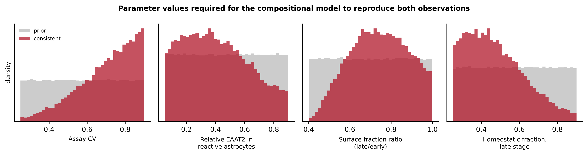

Alper Karagöl^1,†,\*^ and Taner Karagöl^1,¶,\*^

^1^ Istanbul University Istanbul Medical Faculty, Istanbul, Turkey. ^†^ Present address: Broad Institute of MIT and Harvard; Department of Mechanical Engineering, MIT, Cambridge, MA, USA. ^¶^ Present address: McGovern Institute for Brain Research, MIT, Cambridge, MA, USA. ^\*^ Correspondence: akaragol@mit.edu; karagolt@mit.edu

## Contents

| Section | Content | Items |
|---|---|---|
| S1 | Full extraction matrix | Table S1 |
| S2 | Reference verification audit | — |
| S3 | Leave-one-out sensitivity of the implied effect size | Table S2 |
| S4 | Moderator robustness under alternative preparation coding | Table S3 |
| S5 | Exact confidence interval for the moderator odds ratio | — |
| S6 | Monte Carlo calibration of the compositional model | Table S4, Figure S1 |
| S7 | Quantification of denominator bias from neuronal loss | Table S5 |
| S8 | Failure of vote-counting, and publication-bias stress test | Tables S6, S7 |
| S9 | Sample size for the proposed IPD design | Table S8 |
| S10 | Reproducibility | Table S9 |
| S11 | Publication-bias adjustment of the implied effect size | Table S10 |
| S12 | Power of the largest studies re-benchmarked | Table S11 |
| S13 | Preparation moderator under direction-specific coding | Table S12 |

The Supplementary Material comprises twelve tables (S1–S12) and one figure (S1). Sections S11–S13 report sensitivity analyses that qualify the main-text findings. All analyses were performed in Python 3 with NumPy and SciPy. Random-number seeds are fixed. The accompanying analysis script regenerates every number reported here and in the main text.

\newpage

## S1. Full extraction matrix

Coding conventions. *Preparation:* fraction-resolved = membrane, lipid raft, detergent-insoluble or immunoprecipitated fractions; homogenate = whole-lysate Western blot or ELISA; imaging = immunohistochemistry or quantitative immunofluorescence; binding = ligand binding or uptake kinetics. *Direction:* −1 reduced in AD, 0 no change, +1 increased. *Significant* is as reported by the original authors at α = 0.05.

| Study | Year | Region | Preparation | n (C/AD) | Dir. | Sig. | Note |
|---|---|---|---|---|---|---|---|
| Rothstein | 1992 | multiregion | binding | 17/15 | 0 | no | Vmax and Kt unchanged |
| Masliah | 1996 | midfrontal ctx | binding | not stated | −1 | yes | D-aspartate −34%; L-aspartate −30% |
| Li | 1997 | frontal | homogenate | 4/12 | −1 | yes | protein down; mRNA unchanged |
| Beckstrøm | 1999 | inf. temporal | homogenate | 10/10 | 0 | no | high inter-individual variance |
| Lauderback | 2001 | inf. parietal | fraction | 7/4 | −1 | yes | HNE-adducted GLT-1 |
| Thal | 2002 | multiregion | imaging | 21 | −1 | yes | neuronal EAAT2 accumulation |
| Jacob | 2007 | front/hipp/cbl | homogenate | 10/22 | −1 | yes | platform-discordant |
| Abdul | 2009 | hippocampus | fraction | 12/18 | −1 | yes | deficit present at MCI |
| Sasaki | 2009 | temporal | fraction | 3/4 | −1 | yes | insoluble; co-IP with p-tau |
| Pow & Cook | 2009 | temporal | imaging | 3/3 | −1 | yes | exon-9 variant, neuronal |
| Kirvell | 2010 | frontal BA9/20 | homogenate | 8/7 | 0 | no | — |
| Tian | 2010 | frontal BA9/10 | fraction | 11/6 | −1 | yes | reduced lipid-raft association |
| Woltjer | 2010 | hipp + frontal | fraction | 33/77 | −1 | yes | detergent-insoluble increased |
| Thal | 2010 | occipital | imaging | 309/71 | −1 | yes | capillary CAA subgroup only |
| Simpson | 2010 | lat. temporal | imaging | 42 | −1 | no | inverse GFAP–EAAT2 p = 0.015 |
| Scott | 2011 | 4 cortical | homogenate | 15/12 | −1 | yes | mRNA; variants rise with severity |
| Garcia-Esparcia | 2018 | frontal BA8 | homogenate | 39/20 | 0 | no | GLT1 flat; GFAP and ALDH1L1 up |
| Hoshi | 2018 | temporal | imaging | 5/8 | −1 | yes | plaque-like GLT-1/AQP4 deposits |
| Kobayashi | 2018 | entorhinal | imaging | 19/18 | −1 | yes | AD-D only; AD-N preserved |
| Poirel | 2018 | frontal BA9 | homogenate | 38/133 | 0 | no | no CDR correlation |
| Yeung | 2021 | medial temporal | imaging | 7/6 | 0 | no | increased neuropil signal |

**Table S1.** Full extraction matrix of human post-mortem EAAT2 studies.

The ten comparisons forming the primary abundance analysis set are Li, Beckstrøm, Abdul, Kirvell, Tian, Garcia-Esparcia, Hoshi, Kobayashi, Poirel and Yeung — those testing EAAT2 abundance against a control group with extractable group sizes.

## S2. Reference verification audit

All 41 references were checked against publisher records or against the published reference list of Wood et al. (2022), *Front Neurosci* 16:952096 (PMID 36033606), which was retrieved in full. Thirty-four are confirmed by that list; the remaining seven were confirmed individually (Dai 2023, PMID 37533101; Gabitto 2024; Hefendehl 2016; Lau 2020, PMID 32989152; Sadick 2022; Smith 2022; Soares 2024).

Two errors in the source literature were identified and corrected rather than propagated:

- **Author name.** Wood et al. spell the 2002 tangle-bearing-neuron study "Thai, D. R." in both their Table 1 and their reference list. The publisher record (Brain Pathol 2002;12(4):405–411, PMID 12408226) gives **Thal, D. R.** — the same investigator as the 2010 capillary-CAA study.
- **Author order.** Wood et al. give Masliah et al. (1996) as "Masliah E, Hansen L, Alford M, DeTeresa R, Mallory M". PubMed (PMID 8957017) gives **Masliah E, Alford M, DeTeresa R, Mallory M, Hansen L**. The journal record is followed here.

The effect size attributed to Masliah et al. also required correction. Wood et al. summarise it as "~30% reduction in [³H]aspartate binding"; the primary report gives a **34%** reduction in D-[³H]aspartate binding and a **30%** reduction in L-[³H]aspartate binding, in **midfrontal cortex**.

**One residual sourcing caveat.** The statement in §3.9 of the main text that the SEA-AD homeostatic astrocyte subcluster expresses *SLC1A2* and *NRXN1* derives from a figure caption of Gabitto et al. (2024) rather than the full text. It is independently corroborated by Dai et al. (2023), who show *NRXN1* declining along the astrocyte reactivity trajectory, but readers relying on this specific claim should confirm it against the primary text.

\newpage

## S3. Leave-one-out sensitivity of the implied effect size

The main text reports that the effect size reproducing the observed count of five significant findings among ten abundance comparisons is d = 0.83. Because that estimate is derived from a small set, we recomputed it omitting each study in turn.

| Study omitted | Implied d | Change from full set |
|---|---|---|
| *(full set, 10 studies)* | **0.83** | — |
| Li 1997 | 0.72 | −0.11 |
| Beckstrøm 1999 | 0.91 | +0.08 |
| Abdul 2009 | 0.76 | −0.07 |
| Kirvell 2010 | 0.89 | +0.06 |
| Tian 2010 | 0.73 | −0.10 |
| Garcia-Esparcia 2018 | 0.98 | +0.15 |
| Hoshi 2018 | 0.72 | −0.11 |
| Kobayashi 2018 | 0.78 | −0.05 |
| Poirel 2018 | 0.99 | +0.16 |
| Yeung 2021 | 0.88 | +0.05 |

**Table S2.** Leave-one-out recomputation of the implied effect size.

The estimate ranges from 0.72 to 0.99 and never approaches zero. It is most sensitive to removal of the two adequately powered nulls, Poirel 2018 and Garcia-Esparcia 2018 — removing either *raises* the implied effect, because those studies contribute most of the expected-significant count against which the observed count is compared. The inference that the true effect is moderate-to-large does not depend on any single study, and the interval sits either side of the independently pooled reuptake estimate of 0.75.

## S4. Moderator robustness under alternative preparation coding

Preparation class was coded post hoc. The insoluble-fraction studies (Woltjer 2010, Sasaki 2009) and the immunoprecipitation study (Lauderback 2001) are the ambiguous cases: they interrogate a defined biochemical compartment, which is why they were coded fraction-resolved, but they measure an aberrant species rather than a reduction in normal transporter. We therefore recomputed the Fisher exact test under six codings.

| Coding | 2 × 2 table | Fisher exact p |
|---|---|---|
| **Primary (as reported in main-text Table 5)** | [[5, 0], [1, 4]] | **0.048** |
| Lauderback recoded as imaging | [[4, 0], [1, 4]] | 0.048 |
| Woltjer and Sasaki excluded | [[3, 0], [1, 4]] | 0.143 |
| All insoluble-fraction studies excluded | [[2, 0], [1, 4]] | 0.143 |
| Li 1997 recoded as fraction-resolved | [[6, 0], [0, 4]] | 0.005 |
| Most conservative (fraction = Abdul, Tian only) | [[2, 0], [1, 4]] | 0.143 |

**Table S3.** Sensitivity of the preparation moderator to coding decisions. Cells are [detected, not detected] for fraction-resolved (top row) and total homogenate (bottom row).

**This result is fragile.** Significance is retained under two of six codings and lost under three. The direction of the association is stable — the detection rate for fraction-resolved preparations is 100% under every coding, against 20% for total homogenate — but the p-value is not robust, and the moderator analysis should be treated as hypothesis-generating rather than as an established finding. This is stated in §4.5 of the main text and is the principal reason the proposed confirmatory design (§4.6) enters preparation class as a pre-specified meta-regression moderator rather than assuming it.

## S5. Exact confidence interval for the moderator odds ratio

The primary 2 × 2 table contains a zero cell, so the maximum-likelihood odds ratio is infinite and the Wald interval is undefined. We computed the conditional exact interval by profiling the noncentral hypergeometric likelihood.

- Table: [[5, 0], [1, 4]]
- Conditional exact 95% CI for the odds ratio: **1.02 to ∞**

The lower bound of 1.02 barely excludes unity, which is the same message as Section S4 conveyed by a different route: the association is real in direction but weakly determined in magnitude at this sample size.

\newpage

## S6. Monte Carlo calibration of the compositional model

### Purpose

Section 3.9 of the main text proposes that a shift in astrocyte-pool composition — from an *SLC1A2*-high homeostatic protoplasmic state to GFAP-high reactive states — can hold bulk tissue EAAT2 flat while uptake capacity falls. That is a verbal argument. Here we ask whether it is *quantitatively* possible, and if so under what parameter values.

### Model

Let *f* be the homeostatic fraction of the astrocyte pool, *ρ* the EAAT2 content of a reactive astrocyte relative to a homeostatic one, *g* the fold-change in astrocyte number, *L* the fraction of neurons lost, *π* the neuronal share of total cortical protein, and *s* the ratio of surface-localised transporter fraction late to early. Writing early and late for Braak 0–II and V–VI:

- Bulk EAAT2 per mg total protein ∝ g[f₁ + (1−f₁)ρ] / [f₀ + (1−f₀)ρ] / (1 − πL)
- EAAT2 per astrocyte ∝ [f₁ + (1−f₁)ρ] / [f₀ + (1−f₀)ρ]
- Uptake capacity ∝ (EAAT2 per astrocyte) × s

Ratios were converted to standardised effect sizes as d = ln(ratio)/CV, where CV is the between-subject coefficient of variation of the assay, treated as a free parameter.

### Priors and criterion

400,000 draws from independent uniform priors: f₀ ∈ [0.60, 0.92]; f₁ ∈ [0.25, 0.90]; ρ ∈ [0.05, 0.90]; g ∈ [1.00, 1.80]; L ∈ [0.05, 0.50]; π ∈ [0.40, 0.60]; s ∈ [0.40, 1.00]; CV ∈ [0.25, 0.90]. A draw was counted consistent if it simultaneously produced |d_bulk| < 0.30 (an undetectable change in bulk abundance) and −1.05 < d_uptake < −0.55 (the reported reuptake effect and its approximate confidence interval).

### Result

**6.9% of the prior space satisfies both constraints (27,716 of 400,000 draws).** The model is therefore quantitatively viable, but it is not viable for arbitrary parameter values. An earlier, narrower parameterisation drawn directly from the SEA-AD compositional shift **failed entirely** (0.0% consistent) because it predicted an uptake deficit of d ≈ −2.4, roughly three times the observed effect. That failure is informative and is the reason this analysis is presented as a calibration rather than a validation.

| Parameter | Prior range | Median in consistent subspace | 5th–95th percentile |
|---|---|---|---|
| Homeostatic fraction, early (f₀) | 0.60–0.92 | 0.79 | 0.62–0.91 |
| Homeostatic fraction, late (f₁) | 0.25–0.90 | 0.45 | 0.27–0.76 |
| Relative EAAT2 in reactive astrocytes (ρ) | 0.05–0.90 | 0.39 | 0.09–0.81 |
| Astrocyte number fold-change (g) | 1.00–1.80 | 1.17 | 1.01–1.59 |
| Neuronal loss (L) | 0.05–0.50 | 0.21 | 0.06–0.45 |
| Surface-fraction ratio (s) | 0.40–1.00 | 0.74 | 0.51–0.96 |
| **Assay between-subject CV** | 0.25–0.90 | **0.73** | **0.41–0.89** |

**Table S4.** Parameter values required for consistency with both observations.

{width=100%}

**Figure S1.** Prior (grey) against consistent-subspace (red) distributions for the four most informative parameters. Only the assay coefficient of variation is strongly constrained; the compositional parameters are barely updated, meaning the data do not discriminate among plausible compositional shifts.

### Interpretation and the constraint this places on the model

Three points follow, and the second and third are unfavourable to the model as stated in the main text.

**First**, the model is self-consistent. Median values in the consistent subspace imply per-astrocyte EAAT2 falling to 0.80 of early-stage levels, uptake to 0.57, and bulk abundance at 1.09 — that is, bulk EAAT2 slightly *increased*, because gliosis and neuronal loss both push the per-mg-protein measure upward. This is a sharper prediction than the main text makes and is testable: bulk EAAT2 should be flat to mildly elevated, never reduced.

**Second**, consistency requires a high assay coefficient of variation, median 0.73 with a 5th percentile of 0.41. Only the CV is strongly constrained by the data (Figure S1). This is compatible with the emphasis on inter-individual variability in Beckstrøm et al. (1999) and with the I² of 83% reported for pooled reuptake, but it has not been independently verified, and if true post-mortem assay CV is nearer 0.3 the model cannot reconcile the two observations.

**Third**, the compositional parameters are barely updated from their priors. The data as they stand cannot distinguish a mild compositional shift with large per-cell loss from a severe shift with small per-cell loss. The SEA-AD-scale shift (f₀ ≈ 0.78 to f₁ ≈ 0.40) is compatible but accounts for only 5.3% of the consistent subspace and requires CV ≈ 0.74. The model should therefore be read as demonstrating feasibility, not as an estimate of the underlying parameters.

\newpage

## S7. Quantification of denominator bias from neuronal loss

At Braak V–VI, neuronal dropout reduces total tissue protein, so any measure normalised to total protein or to a ubiquitous loading control is inflated. If neurons contribute a fraction π of cortical protein and a fraction L of neurons is lost, the inflation factor is 1/(1 − πL).

| Neuronal loss (L) | Neuronal share of protein (π) | Inflation factor | Per-astrocyte decline fully masked |
|---|---|---|---|
| 10% | 45% | 1.047 | 4.7% |
| 10% | 55% | 1.058 | 5.8% |
| 20% | 45% | 1.099 | 9.9% |
| 20% | 55% | 1.124 | 12.4% |
| 30% | 45% | 1.156 | 15.6% |
| 30% | 55% | 1.198 | 19.8% |
| 40% | 45% | 1.220 | 22.0% |
| 40% | 55% | 1.282 | 28.2% |
| 50% | 45% | 1.290 | 29.0% |
| 50% | 55% | 1.379 | 37.9% |

**Table S5.** Upward bias in total-protein-normalised EAAT2 measurements induced by neuronal loss, and the true per-astrocyte decline it would exactly cancel.

At levels of hippocampal and entorhinal neuronal loss typical of Braak V–VI, a real per-astrocyte EAAT2 decline of 16–28% would be reported as no change. The bias acts in the direction that manufactures nulls, and it acts most strongly in exactly the regions and stages where the hypothesis predicts the largest true effect. No study in the corpus corrected for neuronal density, and correction requires only a NeuN count on adjacent sections.

## S8. Failure of vote-counting, and publication-bias stress test

### S8.1 Vote-counting

Narrative reviews of this literature have counted significant against non-significant findings. We simulated that procedure, drawing 20,000 replications of the ten abundance studies at their actual group sizes under several true effect sizes, and asking how often a majority of studies would reach significance.

| True effect | Probability that a majority of the ten studies is significant |
|---|---|
| d = 0.0 | 0.0% |
| d = 0.4 | 0.1% |
| d = 0.83 | 29.5% |
| d = 1.2 | 89.9% |

**Table S6.** Vote-counting has almost no power at realistic effect sizes and these sample sizes. Even at the effect size implied by the data, it declares an effect less than a third of the time.

Vote-counting is therefore biased toward the null in this literature and cannot distinguish "no effect" from "no power". This is the classical result of Hedges and Olkin and it applies with full force here.

### S8.2 Publication-bias stress test on the sign test

The main text reports that all seven significant post-mortem findings point downward, giving a two-sided sign test p = 0.016. We asked how many unpublished significant *increases* would be required to overturn it.

| Unpublished increases assumed | Ratio | Two-sided p |
|---|---|---|
| 0 | 7/7 downward | **0.016** |
| 1 | 7/8 | 0.070 |
| 2 | 7/9 | 0.180 |
| 3 | 7/10 | 0.344 |
| 4 | 7/11 | 0.549 |

**Table S7.** Fragility of the directional sign test to unpublished contrary findings.

**A single unpublished significant increase raises p above 0.05.** Given that this literature is dominated by small studies with figure-only reporting — conditions under which non-confirmatory results are least likely to be published — the sign test should be read as consistent with the conclusion rather than as evidence for it. This is why the main text rests its directional argument on the excess-significance analysis, which uses the full pattern of significance and sample sizes rather than only the significant subset.

## S9. Sample size for the proposed IPD design

Two-sided α = 0.05, 80% power. Interaction contrasts require four times the per-arm sample of the corresponding main effect.

| Target effect (d) | n per arm, main effect | n per arm, interaction | Per region (3 Braak strata) | Total (4 regions) |
|---|---|---|---|---|
| 0.25 | 252 | 1,005 | 3,015 | 12,060 |
| 0.30 | 175 | 698 | 2,094 | 8,376 |
| **0.40** | **99** | **393** | **1,179** | **4,716** |
| 0.50 | 63 | 252 | 756 | 3,024 |

**Table S8.** Sample size requirements for the design proposed in §4.6 of the main text.

The design target of d = 0.40 for the region × stage interaction requires roughly 1,180 samples per region and 4,720 across the four proposed regions. This is beyond any single brain bank and is the reason the proposal is framed as individual-participant-data pooling across ROSMAP, MSBB, Mayo and SEA-AD rather than as a new collection. For orientation, the entire existing post-mortem literature synthesised here comprises fewer than 800 AD cases.

## S10. Reproducibility

The accompanying Python script regenerates every statistic in the main text and in this supplement from the extraction matrix in Table S1, with fixed random seeds. It has no dependencies beyond NumPy and SciPy and runs in under a minute.

| Statistic | Value | Location |
|---|---|---|
| Median group size | 10 | Main text §3.4 |
| Power at d = 0.40, n = 10/group | 0.145 | Main text §3.4 |
| Power at d = 0.75, n = 10/group | 0.388 | Main text §3.4 |
| Poirel 2018 power at d = 0.75 | 0.982 | Main text §3.4 |
| Garcia-Esparcia 2018 power at d = 0.75 | 0.764 | Main text §3.4 |
| Excess-significance p against d = 0.40 | 0.0288 | Main text Table 4 |
| Implied true effect size | d = 0.83 | Main text §3.5 |
| Leave-one-out range | 0.72–0.99 | Table S2 |
| Sign test, 7/7 downward | p = 0.0156 | Main text §3.5 |
| Preparation moderator, Fisher exact | p = 0.0476 | Main text Table 5; Table S3 |
| Odds ratio, conditional exact 95% CI | 1.02–∞ | Section S5 |
| Region moderator, Fisher exact | p = 0.5921 | Main text Table 5 |
| Compositional model, consistent prior fraction | 6.9% | Section S6 |
| Required assay CV (median, consistent subspace) | 0.73 | Table S4 |
| Vote-counting power at d = 0.83 | 29.5% | Table S6 |
| Sign test p with one unpublished increase | 0.070 | Table S7 |
| Interaction n per arm at d = 0.40 | 393 | Table S8 |
| Implied d under moderate publication bias (w = 0.5) | 0.60 | Table S10 |
| Implied d under severe publication bias (w = 0.25) | 0.41 | Table S10 |
| Poirel 2018 power at d = 0.30 | 0.37 | Table S11 |
| Garcia-Esparcia 2018 power at d = 0.30 | 0.19 | Table S11 |
| Moderator p, direction-specific coding | 1.000 | Table S12 |
| Sign test on EAAT2-specific findings only | p = 0.031 | Main text §3.5 |

**Table S9.** Index of reported statistics and where each appears.

\newpage

## S11. Publication-bias adjustment of the implied effect size

The excess-significance inversion in Section S3 equates the observed number of significant findings with the sum of per-study powers. That equality holds only if publication is independent of significance — an assumption the main text argues elsewhere is false. Under publication bias the observed significance rate among *published* studies is inflated and the implied effect is biased upward.

Let null results be published with probability *w* relative to significant results, and let *S* be the sum of per-study powers across *k* = 10 comparisons. The expected significant fraction among published studies is

    S / (S + w(k − S))

Setting this to the observed 0.50 gives *S* = *kw*/(1 + *w*), which we then invert for d.

| Null publication rate *w* | Required *S* | Implied d | Bias regime |
|---|---|---|---|
| 1.00 | 5.00 | **0.83** | none (original assumption) |
| 0.75 | 4.29 | 0.73 | mild |
| 0.50 | 3.33 | 0.60 | moderate |
| 0.33 | 2.48 | 0.48 | moderate |
| 0.25 | 2.00 | 0.41 | severe |
| 0.10 | 0.91 | 0.21 | severe |

**Table S10.** Implied effect size as a function of assumed publication bias.

**Consequences for the main text.** Agreement between d = 0.83 and the independently pooled reuptake estimate of 0.75 holds only at *w* ≈ 1, which is not credible for a literature of small studies with figure-only reporting. The value d = 0.83 is therefore reported as an **upper bound**, with a plausible range of 0.41 to 0.83, and the agreement is conditional rather than corroborative.

What survives across every scenario is the lower end. Even at *w* = 0.25, the implied effect is 0.41, and a very small true effect (d ≤ 0.2) requires *w* ≈ 0.10 — that is, nine of every ten null studies going unpublished. The exclusion of a negligible effect is therefore robust; the point estimate is not.

## S12. Power of the largest studies re-benchmarked

Poirel (2018) and Garcia-Esparcia (2018) have 98% and 76% power at d = 0.75 — the pooled effect for **reuptake**. Since the abundance effect is on this account smaller than the functional effect, benchmarking abundance studies at the functional effect size would be circular.

| Assumed true abundance effect | Poirel 2018 (n = 38/133) | Garcia-Esparcia 2018 (n = 39/20) |
|---|---|---|
| d = 0.20 | 0.19 | 0.11 |
| d = 0.30 | 0.37 | 0.19 |
| d = 0.40 | 0.58 | 0.30 |
| d = 0.50 | 0.77 | 0.43 |
| d = 0.75 | 0.98 | 0.76 |

**Table S11.** Power of the two largest abundance studies across plausible true abundance effects.

Neither study reaches 80% power against any abundance effect smaller than d ≈ 0.5. **These studies therefore do not establish preservation.** They exclude an abundance deficit as large as the functional deficit; they do not exclude a small-to-moderate one. This bounds the claims made in §3.4 and §3.6 of the main text.

## S13. Preparation moderator under direction-specific coding

Table 5 of the main text scores a study as having "detected an abnormality" if it reported any deviation from control. This pools reductions in normal transporter (Abdul, Tian) with *increases* in aberrant species — detergent-insoluble EAAT2 (Woltjer), insoluble high-molecular-weight complexes (Sasaki), HNE adducts (Lauderback) — while homogenate studies are scored only on whether normal transporter fell.

Because fraction-resolved studies are designed to isolate an aberrant species, this coding makes detection close to inevitable for that class, and the test approaches tautology. The decisive alternative, not among the six codings examined in Section S4, restricts detection to a *reduction in normal transporter*.

| Coding | 2 × 2 table | Fisher exact p |
|---|---|---|
| Any abnormality (as scored in Table 5) | [[5, 0], [1, 4]] | 0.048 |
| **Reduction of normal transporter only** | [[2, 3], [1, 4]] | **1.000** |
| Reduction only, insoluble studies excluded | [[2, 1], [1, 4]] | 0.464 |

**Table S12.** The preparation moderator under direction-specific coding. Cells are [detected, not detected] for fraction-resolved (top row) and total homogenate (bottom row).

**The association does not survive.** Under the stricter and more defensible definition there is no association whatever between preparation class and detection of an EAAT2 reduction. The nominal p = 0.048 reported in the main text depends entirely on treating an increase in aggregated transporter as equivalent to a decrease in functional transporter.

The conditional exact 95% confidence interval for the odds ratio reported in Section S5 (1.02 to ∞) should be read in this light: it was computed on the permissive coding, and its lower bound already sat at the boundary of significance.

**What stands.** Region shows no association with detection under any coding (p = 0.59), and region and preparation are sufficiently confounded in this corpus that neither can be isolated. That is a statement about the limits of the existing literature, and it is unaffected by the coding question. The positive claim that preparation is the operative moderator is accordingly not made in the abstract, the Highlights or §3.6.
